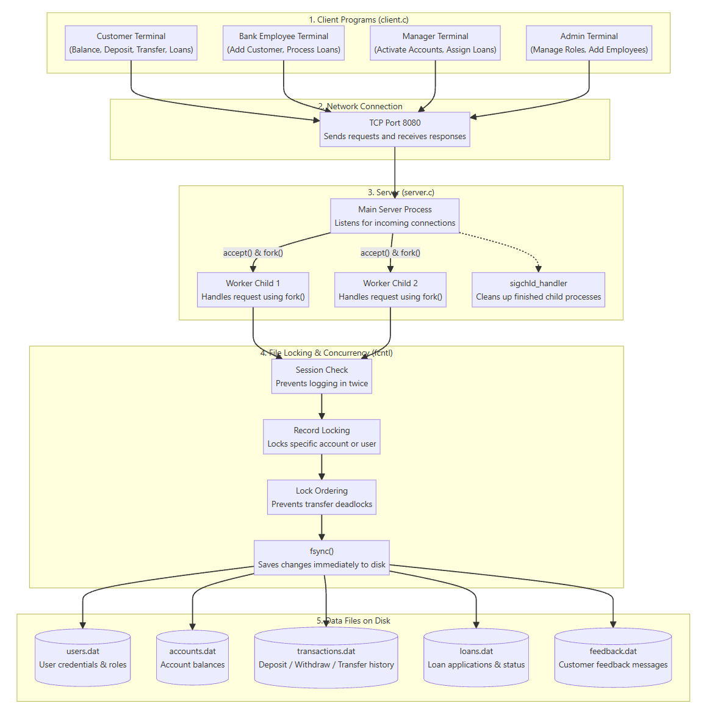
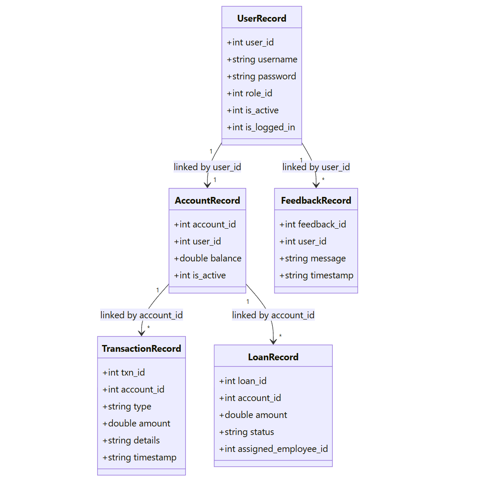

# Banking Management System

An Operating Systems course project implementing a multi-process client-server banking system in C. It uses standard TCP sockets for networking, `fork()` to handle concurrent clients, and POSIX `fcntl` record-level locking on flat binary files to prevent race conditions and maintain data consistency.

---

## 1. System Architecture

The project follows a multi-tier client-server design:



- **Client Tier (`client.c`)**: A terminal-based user interface supporting four distinct roles: Customer, Bank Employee, Manager, and Administrator.
- **Network Tier**: TCP stream socket communication on port 8080 using pipe-delimited text messages (`ACTION|ROLE_ID|USER_ID|...`).
- **Server Tier (`server.c`)**: A master server process that listens on port 8080. When a client connects, the server calls `fork()` to spawn a dedicated worker child process to handle that client's request. Zombie processes are cleaned up automatically via `sigchld_handler()`.
- **Concurrency & Locking Tier (`db.c`)**: Uses POSIX `fcntl()` record-level locking (`F_RDLCK` for reading, `F_WRLCK` for writing) to lock only the specific record being accessed. In money transfers between two accounts, locks are always acquired in ascending file-offset order to eliminate deadlocks. Changes are committed to disk immediately using `fsync()`.
- **Storage Tier**: Five flat binary (`.dat`) files stored locally:
  - `users.dat` - User credentials, roles, active status, and login state (`is_logged_in`).
  - `accounts.dat` - Account numbers, owner user IDs, balances, and active status.
  - `transactions.dat` - Complete log of deposits, withdrawals, transfers, and loan disbursements.
  - `loans.dat` - Loan applications, requested amounts, status, and assigned employee IDs.
  - `feedback.dat` - Customer feedback entries with user ID and timestamp.

---

## 2. Class Diagram & Data Structures

All data entities are defined as fixed-size C structs in `bank.h` and stored directly as binary records:



- **`UserRecord`**: Stores login credentials, role ID, account active status, and single-session login flag.
- **`AccountRecord`**: Linked to `UserRecord` via `user_id`. Stores the account number, balance, and status.
- **`TransactionRecord`**: Linked to `AccountRecord` via `account_id`. Records transaction type, amount, details, and timestamp.
- **`LoanRecord`**: Linked to `AccountRecord` via `account_id`. Stores requested loan amount, status (`PENDING`, `ASSIGNED`, `APPROVED`, `REJECTED`), and the assigned employee ID.
- **`FeedbackRecord`**: Linked to `UserRecord` via `user_id`. Stores customer feedback messages and submission timestamps.

## 3. Concurrency & ACID Properties

Since this project does not use an external database engine, all ACID properties are handled directly in C using low-level UNIX system calls (`fcntl`, `fsync`):

### 1. Atomicity (All-or-Nothing)
- In fund transfers (`db_transfer`), deducting money from the sender and adding it to the recipient happen inside a single critical section while holding write locks on both accounts. If any check fails (such as insufficient balance, deactivated account, or non-existent recipient), no money is moved at all.
- In loan processing (`db_process_loan`), updating the loan status to `APPROVED` and crediting the approved amount to the customer's balance are completed together.

### 2. Consistency
- Balance rules are strictly checked: no withdrawal or transfer can proceed if `balance < amount`, preventing negative account balances.
- Account status checks ensure deactivated accounts (`is_active == 0`) are blocked from logging in, making transactions, or receiving transfers.

### 3. Isolation
- Handled using POSIX `fcntl()` record-level locking (`F_RDLCK` for reading, `F_WRLCK` for writing).
- Only the specific byte offset of the record being accessed is locked. This means multiple clients accessing different accounts run in parallel without waiting on each other.
- **Race Condition Prevention**: If two clients attempt simultaneous withdrawals on the same account, the second process waits for the lock, reads the freshly updated balance, and gets rejected if funds are no longer sufficient.
- **Deadlock Prevention**: In transfers between Account A and Account B, locks are always acquired in ascending order of their file byte offsets (`first_off = min(s_off, t_off)` then `second_off = max(s_off, t_off)`). Because all processes request locks in the exact same order, it breaks the circular wait condition and prevents deadlocks.
- **Single-Session Constraint**: An exclusive lock is acquired on the user record during login to check and update `is_logged_in`, preventing the same user from logging in twice simultaneously.

### 4. Durability
- Standard `write()` system calls in Linux initially write to the operating system's RAM page cache.
- To ensure committed transactions survive unexpected server restarts or power cuts, the code explicitly calls `fsync(fd)` after writing any record to disk before releasing locks and sending a success message back to the client.

---

## 4. How to Compile & Run

### Step 1: Compile the Code
Compile using standard `gcc`:
```bash
gcc init_db.c db.c -o init_db
gcc server.c db.c -o server
gcc client.c -o client
```

### Step 2: Initialize Database (Run Once)
```bash
./init_db
```
This creates fresh `.dat` binary files and populates them with default test accounts.

### Step 3: Start the Server (Terminal 1)
```bash
./server
```

### Step 4: Start the Client (Terminal 2, 3...)
```bash
./client
```
You can open multiple client terminals simultaneously to test concurrent operations and role interactions.

---

## 5. Default Login Credentials

| Role | Username | Password | User ID | Account / Notes |
| :--- | :--- | :--- | :--- | :--- |
| **Customer 1** | `cust1` | `pass` | `101` | Account: 10001 (Starting Balance: $5000.00) |
| **Customer 2** | `cust2` | `pass2` | `102` | Account: 10002 (Starting Balance: $200.00) |
| **Bank Employee** | `emp1` | `pass` | `201` | Staff ID: 201 |
| **Manager** | `mgr1` | `pass` | `301` | Manager ID: 301 |
| **Administrator** | `admin1` | `pass` | `401` | Admin ID: 401 |

---

## 6. Module Features by Role

### 1. Customer
- **View Balance**: Displays current balance and account number.
- **Deposit**: Adds funds to the account and logs the transaction.
- **Withdraw**: Deducts funds after checking for sufficient balance.
- **Transfer**: Atomically transfers money to another account.
- **Apply for Loan**: Submits a loan application in `PENDING` status.
- **Passbook**: Displays transaction history with timestamps.
- **Feedback**: Submits customer feedback messages.
- **Change Password**: Updates personal password.

### 2. Bank Employee
- **Add New Customer**: Creates a new customer login and opens their bank account with an initial balance.
- **Modify Customer Details**: Resets/updates customer passwords.
- **Process Loans**: Reviews assigned loan applications and approves or rejects them. Approving automatically credits the loan amount to the customer's account.
- **View Passbook**: Inspects transaction history for any customer.
- **View Assigned Loans**: Lists loans assigned to this employee by the manager.
- **Change Password**: Updates employee's own password.

### 3. Manager
- **Activate / Deactivate Accounts**: Temporarily disables or reactivates customer accounts. Deactivated accounts cannot log in, deposit, withdraw, or receive transfers.
- **Assign Loans**: Reviews pending loan applications and assigns them to specific bank employees for processing.
- **Review Feedback**: Views all customer feedback submissions.
- **Change Password**: Updates manager's password.

### 4. Administrator
- **Add New Employee**: Creates bank staff accounts.
- **Modify User Details**: Administrative password override for any user.
- **Manage User Roles**: Promotes or changes roles (Customer, Employee, Manager, Admin).
- **Change Password**: Updates administrator password.

---

## 7. File Structure

- `bank.h` - Data structures, constants, and database function prototypes.
- `server.c` - Multi-process TCP server (`socket`, `bind`, `listen`, `accept`, `fork`).
- `client.c` - Interactive CLI menu for Customer, Employee, Manager, and Admin roles.
- `db.c` - File operations with POSIX `fcntl` record-level locking and ACID handling.
- `init_db.c` - Database initializer that creates and seeds the `.dat` files.
- `README.md` - Project documentation and setup instructions.
- `docs/` - Diagram images (`Architecture.png`, `class.png`).

